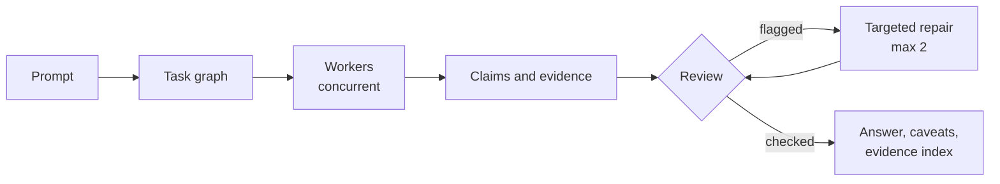
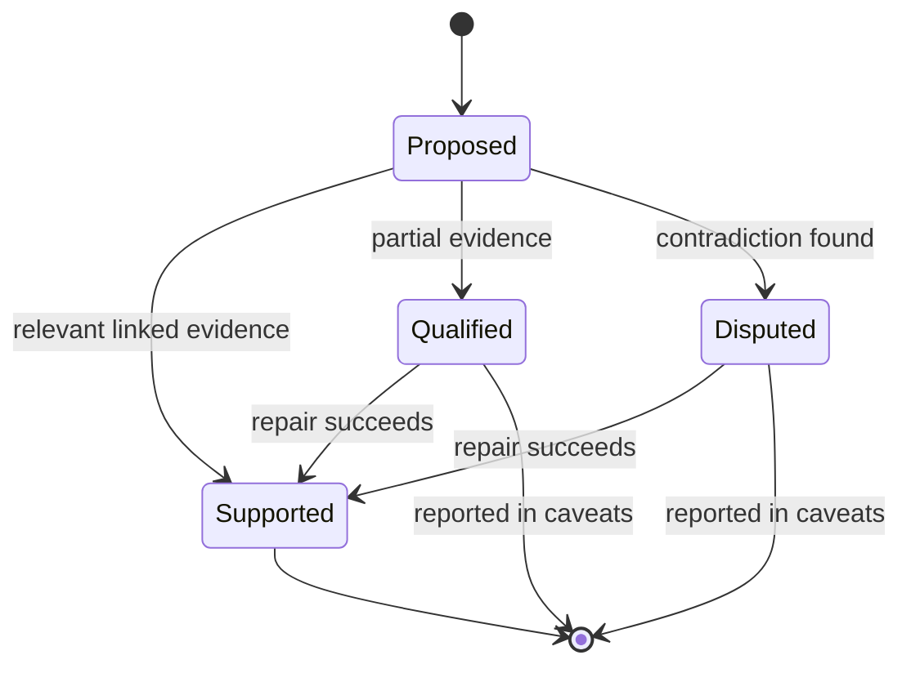
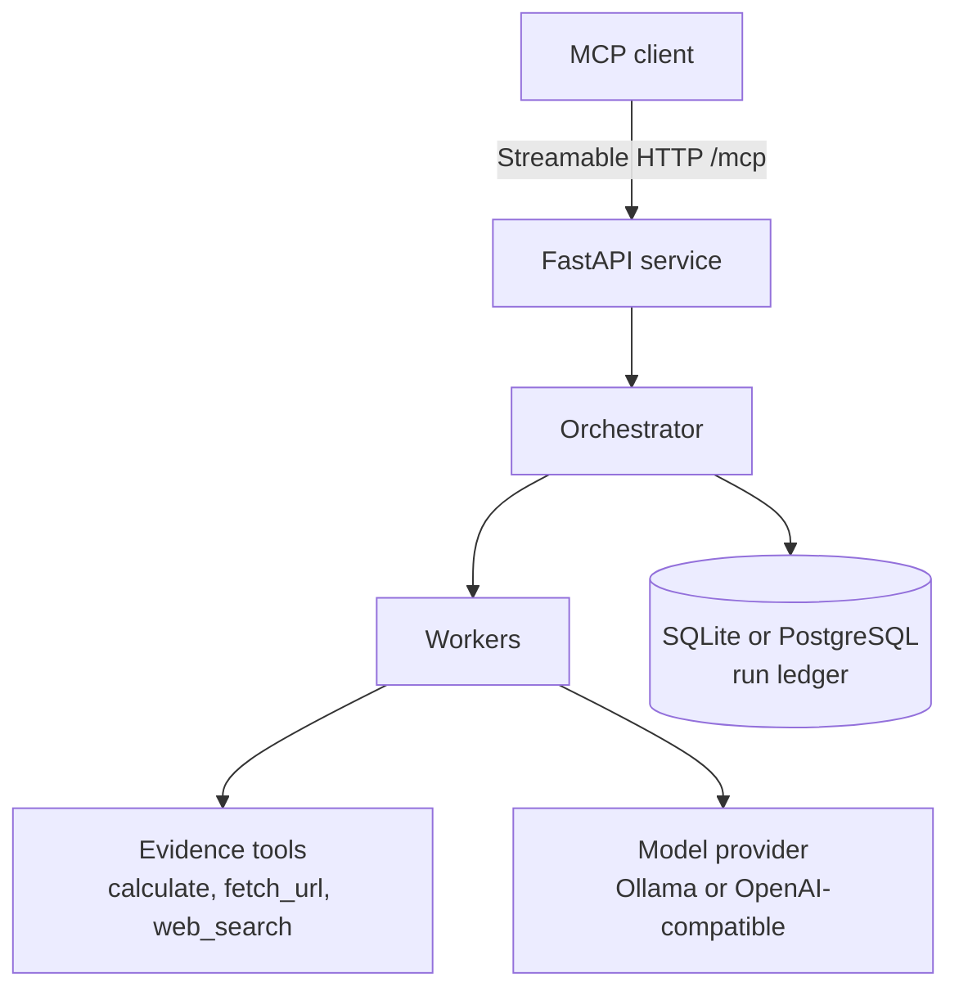

# ProofMesh

Evidence-first multi-agent orchestration, served over MCP.

ProofMesh builds a task graph for each request, runs task-specific workers concurrently, records every run in a ledger, and checks each claim against linked evidence before it can be marked supported.

## Run flow



## Claim status



A claim with no relevant linked evidence cannot be marked supported. Unresolved claims stay qualified or disputed and appear in the caveats.


## Requirements

- Python 3.12+
- An OpenAI-compatible endpoint or Ollama for real model calls (a deterministic `mock` adapter is available for local checks)
- Optional: Brave Search API key for web search

## Quick start

```powershell
uv sync --extra dev
Copy-Item .env.example .env
# Set provider secrets in .env or the process environment
uv run proofmesh
```

| Endpoint | URL |
|---|---|
| Health | `GET http://localhost:8000/health` |
| MCP (Streamable HTTP) | `http://localhost:8000/mcp` |

## Configuration

API keys are read from the environment and never appear in a model profile or output.

| Setting | Purpose |
|---|---|
| `PROOFMESH_OLLAMA_BASE_URL` | Ollama endpoint |
| `PROOFMESH_OPENAI_BASE_URL` | OpenAI-compatible endpoint |
| `PROOFMESH_OPENAI_API_KEY` | OpenAI-compatible API key |
| `PROOFMESH_DATABASE_URL` | Database URL (default: SQLite) |
| `PROOFMESH_MAX_BUDGET_TOKENS` | Per-run token cap (default: 50,000) |
| `PROOFMESH_SEARCH_PROVIDER` | Set to `brave` to enable `web_search` |
| `PROOFMESH_SEARCH_API_KEY` | Search provider key |

Model profiles:

```json
{ "provider": "ollama", "model": "qwen2.5:7b" }
{ "provider": "openai_compatible", "model": "your-model" }
```

PostgreSQL:

```powershell
uv sync --extra postgres
```

```env
PROOFMESH_DATABASE_URL=postgresql+asyncpg://...
```


## Architecture



## MCP tools

| Tool | Description |
|---|---|
| `proofmesh_run_task` | Execute a prompt. Accepts `model_profile`, `max_agents`, `review_rounds`, `budget_tokens`, and optional `context_refs`. |
| `proofmesh_get_run` | Stage, status, task completion, token usage, timestamps. |
| `proofmesh_get_result` | Answer, caveats, claims, evidence index, metadata. |
| `proofmesh_get_evidence` | A claim's linked excerpts and review history, scoped to its run. |
| `proofmesh_compare_blind` | Run the single-agent baseline and the network on the same prompt, profile, and budget. Returns anonymized X/Y answers; the mapping and metrics are kept in `benchmark_pairs`. |
| `proofmesh_list_capabilities` | Available providers and evidence tools, without secrets. |

## Evidence tools

| Tool | Behavior |
|---|---|
| `calculate` | Numeric arithmetic only. Does not call Python `eval`. |
| `fetch_url` | Public HTTP(S) hosts only. Blocks private and local addresses. Does not follow redirects. |
| `web_search` | Unavailable unless the Brave provider and key are configured. A missing provider yields an explicit unavailable record, never synthetic citations. |

## Notes

- Evidence excerpts are capped at 1,200 characters.
- Review can request up to two targeted repairs.
- Provider usage is recorded. Estimated cost is null unless a provider-specific pricing adapter is configured.
- `context_refs` are accepted by the request contract but only recorded in this release. Arbitrary server paths are not read. Pass authorized documents through a future context adapter.

## Tests

```powershell
uv run pytest
```

Tests use local schemas and deterministic mock components. No paid API key is required.
